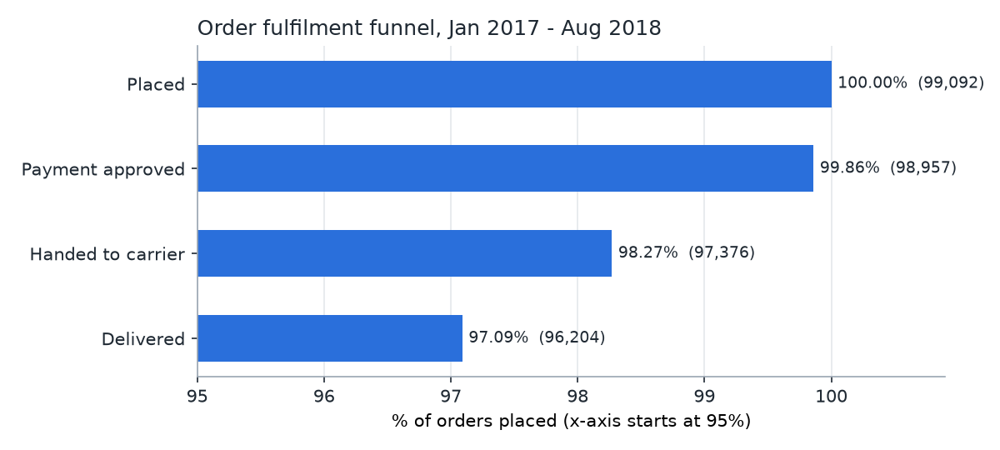
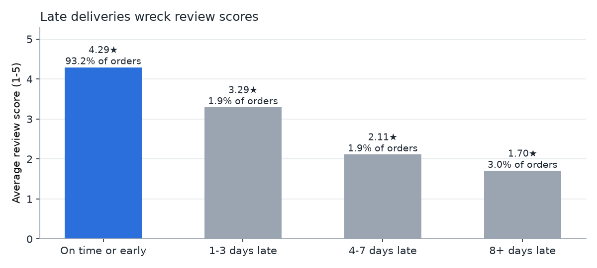
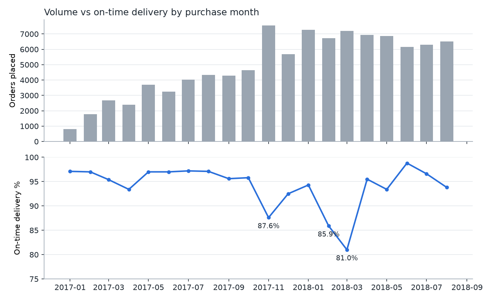
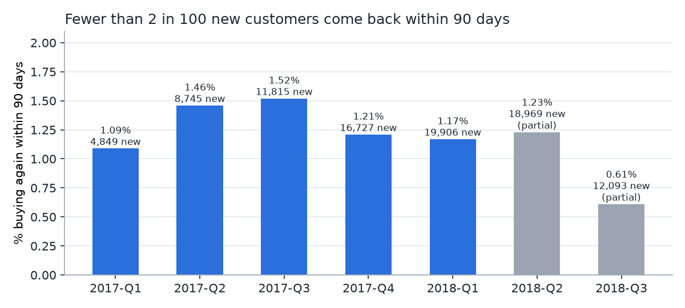
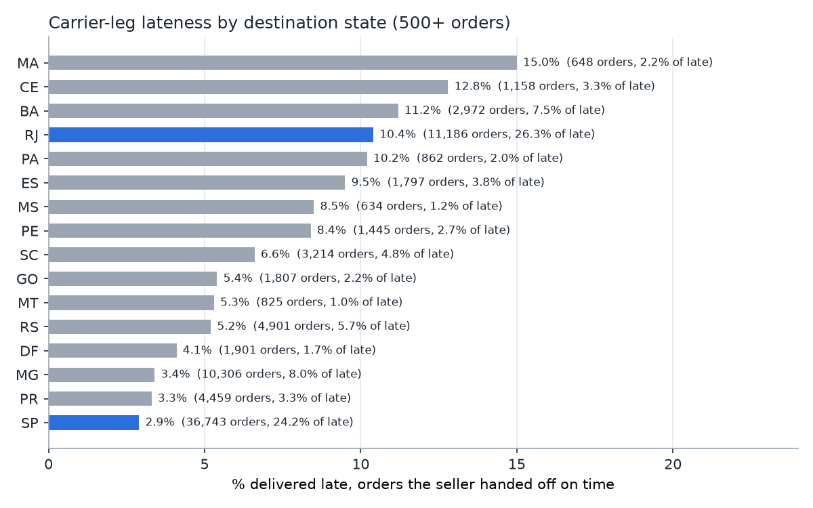

# E-commerce Funnel & Delivery Analysis (DuckDB + SQL)

**Business question:** a Brazilian online marketplace takes ~100k orders. Where do orders drop out between checkout and the customer's door, how much revenue is lost there, and how much does delivery reliability cost in customer satisfaction?

## TL;DR
- **97.1% of 99,092 orders are delivered.** The 2,888 that aren't carried ~R$414k of item value, and the biggest leak is paid orders that never leave the seller (1,581).
- **Late delivery drives bad reviews.** Only 6.8% of orders arrive late, but 8+ days late means 1–2★ 79.1% of the time (vs 9.2% on time).
- **The carrier leg, not the seller, causes most lateness.** 72.3% of late orders were handed off on time. Rio de Janeiro alone is 26.3% of carrier-side late orders.
- **Almost nobody comes back.** 2.15% of customers repeat, yet they are worth ~2× a one-time buyer, and 90-day retention didn't improve as volume grew 4×.

## Data
[Brazilian E-Commerce Public Dataset by Olist](https://www.kaggle.com/datasets/olistbr/brazilian-ecommerce): real, anonymised marketplace orders from 2016 to 2018. It's downloaded from Olist's public GitHub mirror ([`olist/work-at-olist-data`](https://github.com/olist/work-at-olist-data)) by `scripts/download_data.py`. The raw CSVs (~62 MB) aren't committed.

**Licence:** the dataset is © Olist and published under [CC BY-NC-SA 4.0](https://creativecommons.org/licenses/by-nc-sa/4.0/) (see the [Kaggle page](https://www.kaggle.com/datasets/olistbr/brazilian-ecommerce)). This repo uses it for non-commercial analysis and redistributes only derived aggregates.

| Table | Rows |
|---|---:|
| orders | 99,441 |
| order_items | 112,650 |
| order_payments | 103,886 |
| order_reviews | 99,224 |
| customers | 99,441 |
| products | 32,951 |
| sellers | 3,095 |

The analysis window is orders placed **2017-01-01 to 2018-08-31** (99,092 orders). The months before and after it have only a handful of orders.

## Approach
1. **Load** (`pipeline/build_db.py`): each CSV goes into a typed DuckDB table, plus an `orders_clean` view for the analysis window. Data-quality checks run on load: no duplicate orders, no orphan items or customers, no deliveries before purchase, no negative prices. 8 orders are marked `delivered` but have no delivery date; they're reported, not dropped.
2. **Query** ([`sql/`](sql/)): each file answers one business question and is commented.
3. **Report** (`report/build.py`): runs every query and writes [`results/REPORT.md`](results/REPORT.md), CSVs and charts.

## Findings

### 1. 97.1% of orders reach the customer; 2,888 don't
| Stage | Orders | % of placed |
|---|---:|---:|
| Placed | 99,092 | 100.00 |
| Payment approved | 98,957 | 99.86 |
| Handed to carrier | 97,376 | 98.27 |
| Delivered | 96,204 | 97.09 |



The biggest leak is **between approval and carrier hand-off** (1,581 orders): orders that are paid for but never leave the seller. The next biggest is **after hand-off** (1,172 orders), which are lost in transit.

### 2. Undelivered orders carried ~R$414k of item value
| Stalled status | Orders | Item value (R$) |
|---|---:|---:|
| shipped | 1,097 | 175,658 |
| unavailable | 602 | 0 (no items recorded) |
| canceled | 579 | 102,453 |
| processing | 299 | 68,981 |
| invoiced | 296 | 65,707 |
| other | 15 | 1,620 |

2,591 of the 2,888 were placed before July 2018, at least ~2.5 months before the data snapshot ends (October 2018). So they are genuinely stuck, not still in transit. The 1,097 "shipped but never delivered" orders are the largest pot of value.

### 3. Late delivery is the biggest driver of bad reviews
| Delivery vs promised date | % of delivered orders | Avg review | % 1–2★ |
|---|---:|---:|---:|
| On time or early | 93.2 | 4.29 | 9.2 |
| 1–3 days late | 1.9 | 3.29 | 32.2 |
| 4–7 days late | 1.9 | 2.11 | 67.6 |
| 8+ days late | 3.0 | 1.70 | 79.1 |



Only 6.8% of orders (6,532) arrive late, but an order that is 8+ days late is **8.6× more likely** to get a 1–2★ review than one that arrives on time (79.1% vs 9.2%).

### 4. Reliability broke under peak volume


On-time delivery held at about 95–97% through most of 2017. It dropped to **87.6% in November 2017**, the Black Friday month and the busiest month in the data (7,544 orders), and fell further to **85.9% in Feb 2018 and 81.0% in Mar 2018**. It recovered from April 2018, and the median time to deliver fell from 13–14 days to 7–9 days.

### 5. Almost every customer buys once
A customer is a `customer_unique_id` (Olist issues a new `customer_id` for every order). Only delivered orders count (96,211), and a second order on the same day as the first is treated as a split basket, not loyalty.

| Segment | Customers | % customers | Revenue (R$, items + freight) | % revenue | Avg lifetime value (R$) |
|---|---:|---:|---:|---:|---:|
| One-time | 91,099 | 97.85 | 14,733,930 | 95.81 | 161.74 |
| Repeat (2+ buying days) | 2,005 | 2.15 | 643,880 | 4.19 | 321.14 |

Repeat customers are worth about **2× a one-time customer**, but only 2.15% of customers ever come back. The median gap to the second order is 74 days.



Retention didn't improve as the marketplace grew. Among complete cohorts, the share of new customers who bought again within 90 days peaked at **1.52% (2017-Q3)** and slipped to **1.17% (2018-Q1)**, while new-customer volume grew 4×. The 2018-Q2 and Q3 cohorts are partial because their 90-day window runs past the end of the data.

### 6. Most late orders left the seller on time: the carrier leg is the problem
Each seller has a hand-off deadline (`shipping_limit_date`). Splitting delivered orders by whether the seller met it:

| Seller hand-off | Orders | % of orders | Late rate | % of all late orders |
|---|---:|---:|---:|---:|
| On time | 87,622 | 91.1 | 5.4% | 72.3 |
| Missed the deadline | 8,581 | 8.9 | 21.1% | 27.7 |

A missed hand-off makes an order ~4× more likely to arrive late, but **72% of late orders were handed off on time**. Seller SLAs matter, but they're not the main lever.

Product category doesn't explain it either ([`sql/08_category_drivers.sql`](sql/08_category_drivers.sql)). Among the 12 biggest categories, late rates sit in a narrow 5.4–8.2% band, and the biggest categories (bed/bath/table 10.6%, health/beauty 9.9% of late orders) are simply the biggest by volume. Cancellation/unavailable rates are below 1% for almost every category; the 8 above 1% have only 59–627 orders each.

Destination is what separates good from bad ([`sql/09_late_by_state.sql`](sql/09_late_by_state.sql), on-time hand-offs only):



São Paulo (SP), the core market, is late only 2.9% of the time. **Rio de Janeiro (RJ) is late 10.4% of the time and accounts for 26.3% of these carrier-side late orders**, more than SP's 24.2% from a third of the volume. RJ's median promise (25 days) is barely longer than Minas Gerais's (MG, 24 days, 3.4% late), so RJ's promise isn't padded for its actual delivery risk. The north-east (MA 15.0%, CE 12.8%, BA 11.2%) is worse in rate but smaller in volume.

## Recommendations
Ranked by impact on revenue and ratings. Each is tied to a figure above.

| # | Recommendation | Evidence | Owner |
|---|---|---|---|
| 1 | **Set promised dates by destination risk.** Add buffer days for RJ and the north-east (MA, CE, BA), where on-time hand-offs are still late 10–15% of the time. | §6: RJ 10.4% late on a 25-day promise vs MG 3.4% on 24 days | Logistics / product |
| 2 | **Review the RJ carrier contract and routes.** One state produces over a quarter of carrier-side late orders. | §6: RJ = 26.3% of carrier-side late, more than SP from a third of the volume | Logistics |
| 3 | **Plan peak capacity before Black Friday and Q1.** On-time fell to 87.6% (Nov 2017) and 81.0% (Mar 2018). | §4 | Operations |
| 4 | **Proactively contact customers on late orders.** Once an order passes its promise date, send an update or voucher before the review request. | §3: 1–2★ rate rises from 9.2% to 79.1% | Customer service |
| 5 | **Chase "shipped but never delivered" orders.** Set a tracking cut-off and file carrier claims. | §2: 1,097 orders, ~R$176k | Finance / logistics |
| 6 | **Enforce seller hand-off SLAs.** Flag sellers who miss deadlines and paid orders that stall before shipping. | §1: 1,581 paid orders never shipped; §6: missed hand-off → 21.1% late | Seller operations |
| 7 | **Launch a second-order programme.** A follow-up offer around day 60–75 after a good (on-time) delivery. Moving 90-day repeat from ~1.2% to 2.5% would roughly double the repeat segment. | §5: 2.15% repeat, ~2× lifetime value, median 74 days to the 2nd order | Marketing / CRM |

## Limitations
- **No web or app events.** The "funnel" starts at a placed order, so it says nothing about browsing or cart abandonment.
- **Historical data (2017–2018)** from one marketplace. The patterns are a case study, not a forecast.
- **Review scores are a proxy for satisfaction**, and they reflect only the customers who left one.
- **Correlation, not causation.** Late orders get worse reviews, but other factors (product quality, seller service) also play a part.
- **Customer identity** relies on Olist's `customer_unique_id`. Someone using a different email or document counts as a new customer, so repeat rates may be slightly understated.
- **"Unavailable" orders have no items**, so their lost value is unknown and the ~R$414k is a lower bound.

## How to run
```bash
python -m venv .venv && source .venv/bin/activate
pip install -r requirements.txt
python scripts/download_data.py   # ~62 MB into data/raw/
python -m pipeline.build_db       # builds data/olist.duckdb + runs quality checks
python -m report.build            # results/REPORT.md, results/csv/, results/charts/
pytest                            # offline tests on a tiny fixture
```
